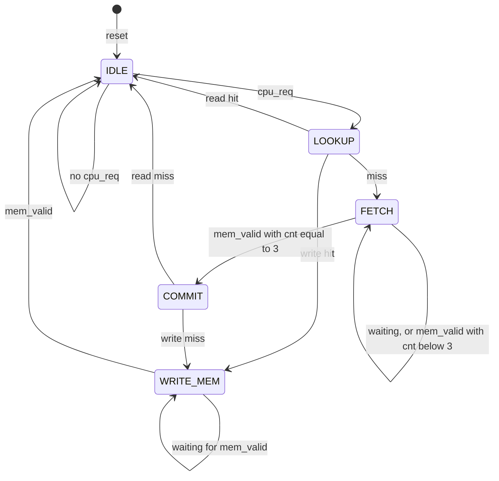

# Cache Controller v1 — FSM Design

This document specifies the controller FSM: its five states, every transition, what each state outputs, and what happens at each clock edge. It builds on the behavior defined in [`architecture.md`](architecture.md). Storage and datapath details are in [`datapath_design.md`](datapath_design.md).

## 1. States

| State | Role |
|---|---|
| `IDLE` | Accepts a CPU request and registers it. `cache_ready = 1`. The registered `cache_valid` pulse of a finished transaction is also visible here. |
| `LOOKUP` | Compares valid and tag on the registered address. Decides hit or miss. On a write hit, performs the single array byte write. |
| `FETCH` | Reads the 4-byte block from memory as one continuous burst, driven by a 2-bit counter. Captures each byte into the temp buffer, merging the CPU byte on a write miss. |
| `COMMIT` | Writes valid, tag and all four data bytes into the cache array in one cycle. |
| `WRITE_MEM` | Sends the single modified byte to memory and waits for `mem_valid`. |

State encoding is 3 bits.

## 2. State diagram



Every arrow into `IDLE` from `LOOKUP`, `COMMIT` or `WRITE_MEM` is a completion. The registered `cache_valid` pulse appears in the `IDLE` cycle that follows.

## 3. Transitions and clock-edge actions

| State | Condition | Register / array actions | Next |
|---|---|---|---|
| `IDLE` | `cpu_req` | load `req_addr`, `req_is_write`, `req_wdata` | `LOOKUP` |
| `IDLE` | no `cpu_req` | none | `IDLE` |
| `LOOKUP` | read hit | `cache_rdata_r <= data[index][offset]`, `cache_valid_r <= 1` | `IDLE` |
| `LOOKUP` | write hit | array byte write: `data[index][offset] <= req_wdata` | `WRITE_MEM` |
| `LOOKUP` | miss | `cnt <= 0` | `FETCH` |
| `FETCH` | no `mem_valid` | hold | `FETCH` |
| `FETCH` | `mem_valid`, `cnt < 3` | `temp_buffer[cnt] <= (req_is_write && cnt == offset) ? req_wdata : mem_rdata`, `cnt <= cnt + 1` | `FETCH` |
| `FETCH` | `mem_valid`, `cnt == 3` | same capture, `cnt` stays at 3 | `COMMIT` |
| `COMMIT` | read miss | line write: `valid[index] <= 1`, `tag[index] <= tag`, `data[index][0..3] <= temp_buffer[0..3]`; `cache_rdata_r <= temp_buffer[offset]`, `cache_valid_r <= 1` | `IDLE` |
| `COMMIT` | write miss | same line write | `WRITE_MEM` |
| `WRITE_MEM` | no `mem_valid` | hold | `WRITE_MEM` |
| `WRITE_MEM` | `mem_valid` | `cache_valid_r <= 1` | `IDLE` |

Defaults on every clock edge:

- `cache_valid_r` clears unless a completion row above sets it. This produces the one-cycle pulse.
- `mem_valid` is ignored in every state except `FETCH` and `WRITE_MEM`.

In `IDLE`, if both `cpu_read` and `cpu_write` are high, `req_is_write` is set (write wins). If neither is high, `req_is_write` is cleared and the request is treated as a read.

## 4. Outputs per state

These outputs depend on the state alone (Moore).

| State | `cache_ready` | `cache_m_req` | `cache_m_read` | `cache_m_write` | `cache_m_addr` | `cache_m_wdata` |
|---|---|---|---|---|---|---|
| `IDLE` | 1 | 0 | 0 | 0 | don't care | don't care |
| `LOOKUP` | 0 | 0 | 0 | 0 | don't care | don't care |
| `FETCH` | 0 | 1 | 1 | 0 | `{req_addr[7:2], cnt}` | don't care |
| `COMMIT` | 0 | 0 | 0 | 0 | don't care | don't care |
| `WRITE_MEM` | 0 | 1 | 0 | 1 | `req_addr` | `req_wdata` |

`cache_valid` and `cache_rdata` come directly from the registers `cache_valid_r` and `cache_rdata_r`. They are register outputs, not decodes of the current state.

`cache_m_read` and `cache_m_write` are never both 1, by construction.

## 5. Timing consequences of the design

- `cache_m_req` is high in `FETCH` and `WRITE_MEM` only. It therefore drops in `COMMIT`, one cycle after the last `mem_valid`, and re-rises in `WRITE_MEM` as a new transaction.
- The counter increments on the edge where `mem_valid` is sampled, so the next byte's address appears the following cycle.
- The `cache_valid_r` pulse is set on the edge that enters `IDLE`. If the CPU's next request is accepted in that same cycle, the FSM goes `IDLE -> LOOKUP` while the pulse clears on the next edge.

### Cycles from the acceptance cycle (cycle 0) to the cycle where `cache_valid` is high

`d` is the delay of a single memory transaction (2 to 8). `D` is the sum of the four burst delays of a line fill (8 to 32).

| Transaction | Cycles |
|---|---|
| Read hit | 2 |
| Write hit | d + 3 |
| Read miss | D + 7 |
| Write miss | D + d + 8 |

Worked read hit:

```text
cycle:         0 (IDLE)   1 (LOOKUP)   2 (IDLE)
state:         IDLE       LOOKUP       IDLE
cache_ready:   1          0            1
cache_valid:   0          0            1
cache_rdata:   -          -            D
```

Worked write (the shape is the same for hit and miss from `WRITE_MEM` onward), with `mem_valid` in cycle N:

```text
cycle:         N (WRITE_MEM)   N+1 (IDLE)
mem_valid:     1               0
cache_ready:   0               1
cache_valid:   0               1
```

## 6. Transaction sequences

**Read hit:** `IDLE -> LOOKUP -> IDLE`

**Read miss:** `IDLE -> LOOKUP -> FETCH (x4 bytes) -> COMMIT -> IDLE`

**Write hit:** `IDLE -> LOOKUP -> WRITE_MEM -> IDLE`

**Write miss:** `IDLE -> LOOKUP -> FETCH (x4 bytes) -> COMMIT -> WRITE_MEM -> IDLE`

A read never enters `WRITE_MEM`. A hit never enters `FETCH` or `COMMIT`.

## 7. Rules and invariants

1. The accepted request is retained in registers (`req_addr`, `req_is_write`, `req_wdata`). No state after `IDLE` reads the live CPU inputs.
2. The memory interface follows the stability contract: address, command and write data are held until `mem_valid`.
3. The counter never advances past 3. At `cnt == 3` the capture happens and the FSM leaves `FETCH`.
4. The fourth byte is captured before the FSM enters `COMMIT`, so `COMMIT` always sees the complete buffer.
5. The cache array is written exactly once per write transaction: once in `LOOKUP` on a write hit, once in `COMMIT` on a write miss. `WRITE_MEM` never writes the array.
6. `cache_valid` is high for exactly one cycle per transaction.
7. A cache line is never valid with partial data (the atomic-commit invariant).

## 8. Design rationale

- **A single `FETCH` state with a counter.** The burst is one continuous mechanism in the architecture, so it maps to one state. Four separate states would duplicate the same logic with different constants. Speed is identical either way, since it is set by memory latency.
- **A dedicated `LOOKUP` state.** It keeps the FSM a clean Moore machine and leaves the storage free to be register-based or BRAM-based later. The cost is one extra cycle per hit.
- **A dedicated `COMMIT` state.** If the commit were folded into the last `FETCH` cycle, the just-arrived fourth byte would need to bypass the buffer, giving the array write an asymmetric datapath. A separate cycle keeps all four bytes coming from `temp_buffer`. The one extra cycle is small next to the memory latency of a miss.
- **Registered completion.** `cache_ready` is defined as `state == IDLE`, so for `cache_valid` and `cache_ready` to be high together (back-to-back handoff), `cache_valid` has to appear in the `IDLE` cycle. A pass-through of `mem_valid` would make `cache_valid` depend on an input in the same cycle. Registering costs one cycle per write and gives the same behavior for all four transaction types.
- **The array byte write in `LOOKUP`.** `LOOKUP` lasts exactly one cycle, so the write fires exactly once. It lands on the same edge that raises `cache_m_req`, so it stays parallel with the memory write. Tying the write to `WRITE_MEM` would fire it on every cycle of the state.

## 9. Verification targets

These feed the Stage 5 and Stage 6 testbench.

- Outputs in the table of section 4 change only with the state. Register updates happen only on clock edges.
- Memory does not restart a transaction while `cache_m_req` and the address are unchanged.
- The next byte's address appears exactly one cycle after the previous `mem_valid`.
- `cnt` never exceeds 3, and is cleared on entry to `FETCH`.
- A write hit updates the array exactly once; a write miss does not update it again in `WRITE_MEM`.
- Write-miss merge at every offset, including offset 3 (the fourth byte).
- Later states never depend on live CPU inputs: change `cpu_*` after acceptance and check that nothing changes.
- `cache_valid` is exactly one cycle wide, and a request presented in that cycle is accepted.
- `mem_valid` is ignored outside `FETCH` and `WRITE_MEM`.
- Cycle counts match the table in section 5 for each transaction type, given the memory delays used.
- Both edge cases: `cpu_read` and `cpu_write` together (write wins), and neither with `cpu_req` (treated as a read).
- Reset in the middle of a transaction, with the memory model reset as well.
